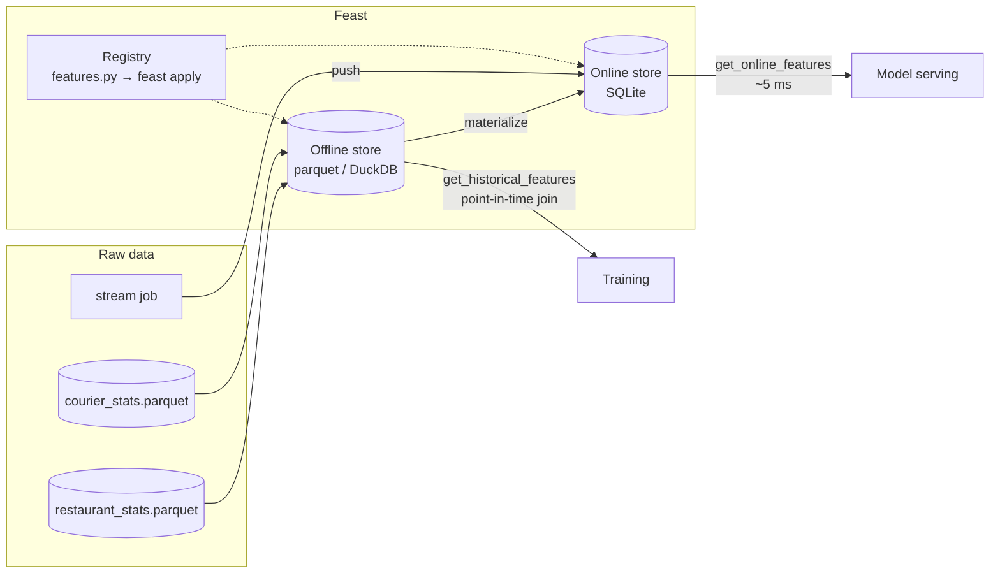

# Feast Feature Store: late-delivery demo

YZV 448E MLOps · tool presentation · Faruk Emre Karaca

A food-delivery app wants to predict **"will this order arrive late?"** at the moment the order is placed.
The model needs features that change all the time (how busy the kitchen is, how fast the courier has been lately),
and it needs the *same* features in two very different places:

* **training**: thousands of historical orders, each joined with the feature values *as they were at order time*
* **serving**: one order, right now, in a few milliseconds

[Feast](https://feast.dev) is the layer that gives you both from one set of feature definitions.

## What the demo shows

| Step | Script | Feast concept | What you see |
|---|---|---|---|
| 0 | `00_generate_data.py` | (data sources) | 2 weeks of hourly restaurant and courier snapshots + 8,000 labelled orders |
| 1 | `feast apply` | registry, entities, feature views, feature service | definitions in `feature_repo/features.py` get registered |
| 2 | `01_point_in_time.py` | `get_historical_features` (point-in-time join) | naive join uses future data for 99% of rows; Feast for 0% |
| 3 | `02_train.py` | training on a feature service | same model, same labels: **AUC 0.82 (naive) vs 0.95 (Feast)** |
| 4 | `03_materialize_and_serve.py` | `materialize_incremental`, `get_online_features` | latest values copied to the online store, orders scored in ~5 ms |
| 5 | `04_push_fresh_features.py` | `PushSource` / `store.push` (streaming) | a kitchen gets slammed, the next request flips from 0% to 98% late |

Full output of a run: [`docs/demo_output.txt`](docs/demo_output.txt). Exact numbers vary slightly per run because the
data is generated relative to the current time.

## Architecture



The `late_delivery_v1` **feature service** is what ties it together: training and serving both ask for it by name,
so the model can never be trained on one set of features and served another.

## Run it

Needs Python 3.10+ (tested on 3.12). No Docker, no cloud account.

```bash
git clone <this repo> && cd feast-demo
python -m venv .venv && source .venv/bin/activate
pip install -r requirements.txt

./demo.sh            # interactive: press Enter between steps
./demo.sh --no-wait  # run everything straight through
```

Or step by step:

```bash
python scripts/00_generate_data.py
cd feature_repo && feast apply && cd ..
python scripts/01_point_in_time.py
python scripts/02_train.py
python scripts/03_materialize_and_serve.py
python scripts/04_push_fresh_features.py
```

### Extras

**Web UI**: browse entities, feature views, the feature service and the lineage graph.

```bash
cd feature_repo && feast ui        # http://localhost:8888
```

**REST feature server**: the same online features for non-Python clients.

```bash
cd feature_repo && feast serve     # port 6566
curl -X POST localhost:6566/get-online-features -H 'Content-Type: application/json' -d '{
  "feature_service": "late_delivery_v1",
  "entities": {"courier_id": [7], "restaurant_id": [1005], "distance_km": [2.5]}
}'
```

## Repo layout

```
feature_repo/
  feature_store.yaml   # where things live: registry, offline store, online store
  features.py          # entities, sources, feature views, on-demand view, feature service
  data/                # generated (gitignored)
scripts/
  00_generate_data.py
  01_point_in_time.py
  02_train.py
  serving.py           # shared online-scoring helper
  03_materialize_and_serve.py
  04_push_fresh_features.py
demo.sh                # presenter script
docs/                  # UI screenshots + saved demo output (backup if the live demo fails)
```

## Going to production

Only `feature_store.yaml` changes. The feature definitions, training code and serving code stay the same:

```yaml
offline_store:
  type: snowflake.offline   # or bigquery, redshift, spark, duckdb, ...
online_store:
  type: redis               # or dynamodb, bigtable, cassandra, postgres, ...
  connection_string: redis:6379
```

Materialization would run on a schedule (Airflow, cron), and `store.push()` would be called from a stream processor
(Kafka + Flink / Spark).

## Notes and gotchas found while building this

* **Request-time inputs are not echoed back.** `distance_km` goes into `get_online_features` for the on-demand view,
  but the response does not contain it. The model input has to merge it back in from the request (`scripts/serving.py`).
* **TTL matters.** `restaurant_stats` has `ttl=2h`: an order with no kitchen snapshot in the previous 2 hours gets a
  null instead of a stale value. Good for correctness, but your model has to handle missing values.
* **Materialization is incremental.** `materialize_incremental` only loads data newer than the last run, so values
  pushed earlier stay in the online store until something newer arrives. `demo.sh` starts from a clean slate for this reason.
* **`feast ui` needs the gRPC extra** (`feast[grpcio]`), otherwise it fails with `No module named 'grpc'`.
* **On-demand feature views are slow offline.** Feast warns that they "don't scale well for offline retrieval":
  they run as pandas per request batch. Fine for light math like this ETA estimate, not for heavy transformations.

## References

* Feast docs: <https://docs.feast.dev>
* Feast quickstart: <https://docs.feast.dev/getting-started/quickstart>
* Feast on GitHub: <https://github.com/feast-dev/feast>
